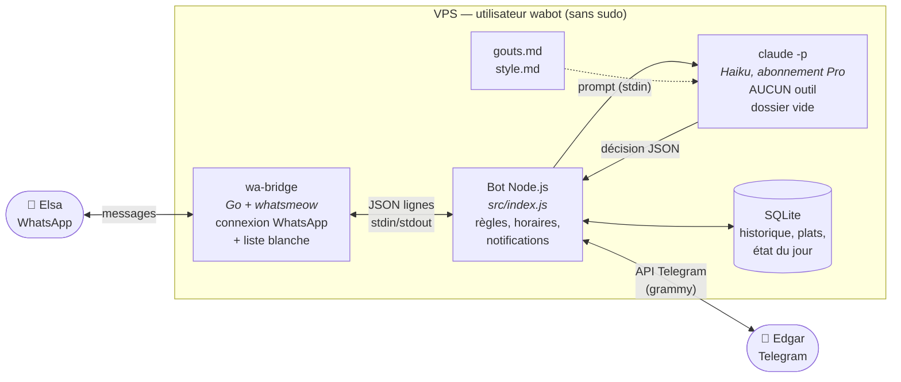
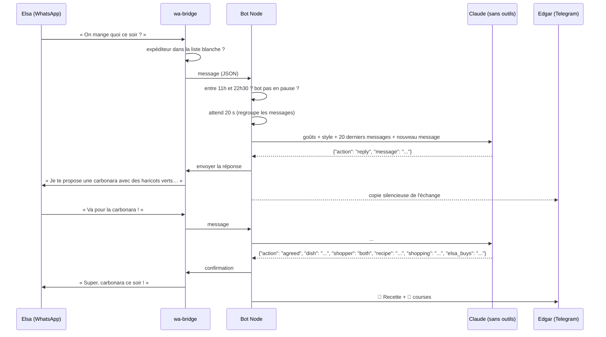

# Bot Menu 🍝

Petit assistant personnel qui s'occupe de la question du soir : **« qu'est-ce qu'on mange ce soir ? »**.

- Chaque jour à **15h30**, il envoie un message WhatsApp à Elsa (depuis un numéro secondaire) — sauf si elle a déjà lancé le sujet après 11h.
- Il discute avec elle **uniquement du dîner de ce soir**, en proposant 2 idées tirées de nos goûts et de nos classiques, jusqu'à ce qu'un plat soit choisi. Il vérifie ce qui reste à la maison et qui achète les produits frais.
- Toutes les 2-3 semaines, il propose aussi d'aller **au restaurant** ; si Elsa accepte, Edgar prend la main.
- Il envoie à Edgar, sur **Telegram**, un message **« Recette : … »** avec la recette et **ses courses** — ou « Elsa s'occupe des courses ».
- Il tient un **répertoire des plats déjà faits** (combien de fois, dernière date) pour reproposer ce qu'on aime sans se répéter.
- Tous les autres messages d'Elsa sont **laissés passer** : pas de réponse, pas de traitement, rien de conservé.

Il tourne sur un petit VPS (500 Mo de RAM), isolé sous un utilisateur Linux dédié `wabot`, sans aucun lien avec les autres projets du serveur.

---

## Architecture



### Le parcours d'un message



### Les décisions possibles de Claude

| Action | Quand | Ce que fait le bot |
|---|---|---|
| `ignore` | Le message ne parle pas du dîner de ce soir | Rien. Le message est effacé de la base. |
| `reply` | La discussion repas continue | Répond à Elsa, copie silencieuse sur Telegram |
| `agreed` | Un plat est choisi et on sait qui achète quoi | Confirme à Elsa (sans recette), note le plat dans le répertoire, puis envoie à Edgar « Recette : … » avec, selon `shopper` : ses courses (`edgar`), ses courses + ce qu'Elsa prend (`both`), « Elsa s'occupe des courses » (`elsa`), « pas de courses » (`none`). Si `restaurant` : prévient Edgar, qui prend la main pour la soirée. |
| `none` | « merci », « ok »… | Ne répond pas |
| `escalate` | Message suspect ou demande d'engagement | Ne répond pas, alerte Edgar sur Telegram |

Si Claude échoue (timeout, réponse invalide, plafond atteint, mémoire insuffisante), **rien n'est envoyé** à Elsa et Edgar reçoit une alerte. Le bot n'invente jamais de réponse.

---

## Les fichiers

```
bot-menu/
├── src/                      Le bot Node.js
│   ├── index.js              Chef d'orchestre : horaires, tri, message de 15h30, commandes Telegram
│   ├── claude.js             Appel à `claude -p` verrouillé (aucun outil), consignes, validation de la réponse
│   ├── whatsapp.js           Lance et pilote wa-bridge (événements et envois en JSON)
│   ├── telegram.js           Bot Telegram : n'obéit qu'à Edgar, notifications, boutons
│   ├── db.js                 Base SQLite (module intégré à Node) : messages, plats du soir, répertoire des plats, état du jour
│   ├── config.js             Lecture de .env, config.json et allowlist.json
│   └── log.js                Journal d'événements — jamais de contenu de message
│
├── wa-bridge/                Le pont WhatsApp (Go)
│   ├── main.go               Connexion via whatsmeow, liaison par code, filtre liste blanche
│   ├── go.mod / go.sum       Bibliothèques et leurs empreintes vérifiées
│   └── build.ps1             Compilation depuis Windows (le VPS n'a pas assez de RAM pour compiler)
│
├── gouts.md                  Nos goûts, habitudes et règles (le petit légume !)
├── style.md                  La façon d'écrire d'Edgar à Elsa
├── plats-initiaux.json       Liste de départ du répertoire des plats (chargée au premier démarrage)
├── config.json               Horaires, ouvertures du message de 15h30, modèle, plafonds
├── allowlist.example.json    Modèle de liste blanche (le vrai fichier n'est pas dans le dépôt)
├── .env.example              Modèle des secrets (le vrai fichier n'est pas dans le dépôt)
├── start.sh                  Lancement dans tmux, redémarrage auto en cas de plantage
└── package.json              Dépendances Node : grammy, qrcode, qrcode-terminal
```

### Sur le serveur uniquement (jamais dans le dépôt)

| Chemin (`/home/wabot/bot/…`) | Contenu |
|---|---|
| `.env` | Token Telegram, ID Telegram d'Edgar, numéro secondaire |
| `allowlist.json` | Numéro d'Elsa |
| `session/wa.db` | Session WhatsApp liée (équivaut à un accès au compte secondaire) |
| `data/bot.db` | Historique des discussions repas, plat de chaque soir (`meals`), répertoire des plats déjà faits (`dishes` : nombre de fois, dernière date) |
| `data/system-prompt.txt` | Consignes envoyées à Claude (régénéré à chaque appel) |
| `logs/bot.log` | Journal d'événements, sans contenu de message |
| `sandbox/` | Dossier vide d'où Claude est lancé |
| `wa-bridge/wa-bridge` | Le programme Go compilé |

---

## Sécurité

- **Isolation** : utilisateur Linux `wabot` sans sudo, dossier en `chmod 700`, aucun accès aux autres projets du VPS.
- **Les messages d'Elsa sont des données, jamais des instructions.** Claude est lancé avec `--tools ""` (aucun outil : il ne peut ni lire de fichier, ni exécuter de commande, ni aller sur internet), `--strict-mcp-config`, `--setting-sources ""`, `--no-session-persistence`, depuis un dossier vide. Le message est envoyé sur l'entrée standard (jamais en argument, visible dans `ps`) et balisé comme donnée.
- **Liste blanche en double** : wa-bridge ne transmet que les messages des numéros autorisés et **refuse d'envoyer** à tout autre numéro ; le bot Node revérifie.
- **Telegram** : le bot n'obéit qu'à l'ID d'Edgar, en conversation privée ; tout le reste est ignoré en silence.
- **Secrets** : `.env` en `chmod 600`, hors du dépôt.
- **Journal** : événements uniquement, jamais de texte de message ; les numéros sont masqués dans les erreurs du pont.
- **Mémoire du VPS** : un seul appel Claude à la fois, refusé si la mémoire libre est trop basse ; le bot est le premier processus sacrifié par Linux en cas de manque (`oom_score_adj=1000`), pour protéger les autres services.
- **Plafonds** : 30 appels Claude par heure, 15 réponses du bot par jour, 1 appel par groupe de messages.

---

## Utilisation

### Commandes Telegram

| Commande | Effet |
|---|---|
| `/statut` | État de WhatsApp, du bot, de la discussion du jour |
| `/envoyer` | Envoie le message du jour tout de suite |
| `/ecrire` | Écrire soi-même à Elsa via le bot |
| `/pause` · `/reprendre` | Couper / réactiver le bot |
| `/gouts` | Afficher le fichier de goûts |
| `/plats` | Derniers soirs et répertoire des plats déjà faits |

Boutons sous les notifications : **✋ Je reprends la main** (le bot se tait pour la journée), **✍️ Répondre**, **🤖 Rendre la main au bot**.

### Sur le serveur

```bash
sudo -iu wabot
~/bot/start.sh                 # démarrer (dans tmux)
tmux attach -t menu            # voir la console (Ctrl-b puis d pour sortir)
tmux kill-session -t menu      # arrêter
tail -f ~/bot/logs/bot.log     # suivre le journal
```

### Réglages (`config.json`)

| Clé | Rôle | Valeur |
|---|---|---|
| `dailyTime` | Heure du message quotidien | `15:30` |
| `conversationStart` / `conversationEnd` | Plage où le bot écoute Elsa | `11:00` → `22:30` |
| `dailyMessages` | Ouvertures possibles (tirées au hasard) | « Coucou mon cœur… » |
| `model` | Modèle Claude | `haiku` |
| `maxClaudeCallsPerHour` / `maxBotRepliesPerDay` | Plafonds | `30` / `15` |
| `debounceSec` | Attente pour regrouper plusieurs messages | `20` |

`gouts.md` et `style.md` sont relus à chaque message : on peut les modifier sans redémarrer.

---

## Mettre à jour wa-bridge

Le VPS n'a pas assez de mémoire pour compiler du Go. On compile sur un PC Windows avec Go installé :

```powershell
cd wa-bridge
powershell -ExecutionPolicy Bypass -File .\build.ps1     # produit wa-bridge (Linux 64 bits) + son empreinte SHA256
scp -i <clé> .\wa-bridge opc@<vps>:/home/opc/wabot-transfer/
```

Puis, sur le serveur, vérifier l'empreinte et installer :

```bash
sha256sum /home/opc/wabot-transfer/wa-bridge      # doit correspondre à celle affichée par build.ps1
sudo -u wabot tmux kill-session -t menu
sudo install -o wabot -g wabot -m 700 /home/opc/wabot-transfer/wa-bridge /home/wabot/bot/wa-bridge/wa-bridge
sudo -iu wabot /home/wabot/bot/start.sh
```

La session WhatsApp est conservée : pas besoin de relier à nouveau.

---

## Historique technique

- **Baileys abandonné** : la liaison de l'appareil échouait (QR et code) à cause de bugs non publiés de la bibliothèque ([#2765](https://github.com/WhiskeySockets/Baileys/pull/2765), [#2872](https://github.com/WhiskeySockets/Baileys/pull/2872)). Remplacé par [whatsmeow](https://github.com/tulir/whatsmeow), plus fiable.
- **SQLite 100 % Go** (`modernc.org/sqlite`) dans wa-bridge, pour pouvoir compiler depuis Windows sans compilateur C ; `_txlock=immediate` évite les erreurs « database is locked ».
- **Pas de service systemd** pour l'instant : lancement manuel dans tmux, en attendant la validation.
